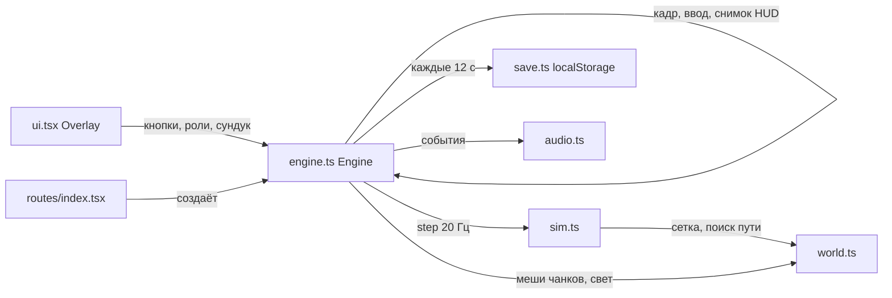

# Камнедол — спецификация механик и аудит архитектуры

Документ описывает то, что реально делает текущий код, а не задумку. Источник правды: `src/game/`. Каркас приложения (`src/lib/auth`, `src/lib/db`, `src/lib/multiplayer`) к игре не подключён.

## 1. Что это за игра

Однопользовательская 3D-крепость в браузере. Игрок не управляет дворфом напрямую: он метит блоки и постройки, а шесть (и больше) дворфов сами ходят, копают, носят, едят, спят и дерутся.

Экраны:

- Посадка (`src/routes/index.tsx`). Имя до 28 символов, по умолчанию «Горн-на-Жиле». «Врубить кирки» стирает сохранение и берёт случайный seed. «Вернуться в зал» есть, только если в `localStorage` лежит сейв версии 2.
- Игра. Канвас Three.js на весь экран, поверх него React-оверлей.

Серверной симуляции нет. Всё состояние живёт в одном объекте `GameState` в памяти вкладки.

## 2. Архитектура

Слои и их единственная работа:

| Слой | Файл | Делает | Не делает |
|---|---|---|---|
| Правила мира | `constants.ts` | Размеры, id блоков, роли, формулы «можно стоять / копать / светить» | Генерацию и ИИ |
| Мир | `world.ts` | Генерация, чанки, свет, меши, A*, луч | Дворфов и экономику |
| Симуляция | `sim.ts` | Время, нужды, задачи, бой, покраска клеток | Рисование |
| Движок | `engine.ts` | Кадр, камера, ввод, меши, актёры, сейв, снимок для UI | Правила боя |
| Интерфейс | `ui.tsx` | Кнопки и листы. Читает только снимок | Прямую мутацию сетки |
| Сейв | `save.ts` | Версия 2 в `localStorage` | Миграцию старых сейвов |
| Звук | `audio.ts` | Короткие осцилляторы | Музыку и сэмплы |

`Engine` — единственный владелец `GameState`. UI подписан через `useSyncExternalStore`: снимок публикуется примерно каждые 280 мс, не каждый тик.

Цикл кадра (`Engine.frame`):

1. Сдвиг камеры с клавиатуры.
2. Догрузить чанки в радиусе 2 вокруг точки взгляда.
3. Если не пауза и крепость не пала: накопить `dt * скорость` и вызвать `step` кусками по 1/20 с, не больше 8 кусков за кадр. Остаток при перегрузе обнуляется.
4. Звук и тряска камеры по событиям.
5. Пересобрать грязные чанки, реквизит, маркеры (маркеры не чаще чем раз в 0.3 с).
6. Подвинуть актёров, свет солнца, туман.
7. Раз в 12 с записать сейв.
8. `renderer.render`.

Скорости: ×1, ×3, ×8 и пауза. ×1 означает, что одна игровая секунда ≈ одна реальная, если кадр успевает. Игровой час равен 1 игровой секунде, сутки — 24. На ×1 сутки длятся около 24 реальных секунд.

## 3. Координаты и сетка

Мир — массив `Uint8Array` длиной `128 × 22 × 128`.

- `SX = 128` по X, `SY = 22` по Y, `SZ = 128` по Z.
- Индекс: `x + 128 * (y + 22 * z)`. X самый быстрый.
- Клетка 1×1×1. Дворф стоит в центре клетки (`+0.5` по X и Z), его Y — целый уровень пола, на котором он идёт.
- Чанк — колонка 16×22×16. Сетка чанков 8×8. `ready[cx + 8*cz] = 1`, если колонка уже сгенерирована.
- Зал: `ROOM` x 56…68, z 60…70. Уровень ходьбы в зале `WALK = 12` (пол на y=11, воздух y=12…14).

Пустая клетка массива — `0`, то есть воздух. Несгенерированный чанк выглядит как воздух, пока камера к нему не подойдёт.

## 4. Блоки

| id | Имя | Куб | Пол | Проход | Копается | Свет не пускает | Дроп при копке |
|---|---|---|---|---|---|---|---|
| 0 | воздух | нет | нет | да | нет | нет | — |
| 1 | трава | да | да | нет | да | да | нет |
| 2 | земля | да | да | нет | да | да | нет |
| 3 | камень | да | да | нет | да | да | 1 камень |
| 4 | руда | да | да | нет | да | да | 1 руда |
| 5 | самоцвет | да | да | нет | да | да | 1 самоцвет |
| 6 | бревно | да | нет | нет | да | нет | 2 дерева |
| 7 | листва | да | нет | нет | да | нет | нет |
| 8 | вода | да | нет | нет | нет | да | — |
| 9 | магма | да | нет | нет | нет | да | — |
| 10 | стена | да | да | нет | да | да | 1 камень |
| 11 | ферма | да | да | нет | да | да | нет |
| 12 | кровать | нет | нет | да | нет | нет | снимается отдельно |
| 13 | брага | нет | нет | да | нет | нет | снимается отдельно |
| 14 | факел | нет | нет | да | нет | нет | снимается отдельно |
| 15 | сундук | нет | нет | нет | нет | да | снимается отдельно |

«Проход» значит, что в клетке можно оказаться. Стоять можно только если сама клетка проходима и под ней твёрдый пол (трава, земля, камень, руда, самоцвет, стена, ферма). Кровать, бражная бочка и факел проходимы, поэтому дворф проходит сквозь них. Сундук непроходим и закрывает свет, но лучом по нему не попадают: луч бьёт только кубы. Открытие сундука ищет сундук в ударенной клетке, в соседней по нормали и на клетку выше.

Боковая грань травы рисуется цветом земли. Верх фермы зелёный, пока рост < 100, и золотой, когда поспела.

## 5. Генерация

`generate(seed)`:

1. Пустые сетка и `ready`.
2. `ensureChunks` радиусом 2 вокруг центра зала (x=61, z=64). Это 5×5 чанков, не вся карта.
3. Карман магмы 2×2 на y=1, рядом с залом, со смещением от seed.
4. Вырезается зал: пол-камень, три клетки воздуха, потолок.
5. Короткий тоннель на восток от зала и за ним стена с одной клеткой руды. Эти клетки сразу помечены к копке.
6. Лестница на север, 15 шагов, пол опускается каждые два шага. Конец лестницы — ворота (`anchors.gate`).
7. У ворот четыре земляные полки, первые две становятся фермами с ростом 55.
8. В зале: 3 кровати, 1 бражная бочка, 4 факела, 1 сундук (4 еды и 2 питья), 6 клеток склада (2×3).

Высота колонки — гребень шума вокруг горы плюс мелкий шум. В пятне зала высота не ниже `WALK+6`. Камень глубже двух клеток от поверхности. Руда — редкий камень не у самой корки (`hash > 0.82`). Самоцветы — ещё реже и только на y=2…5. Деревья: бревно 2 клетки и крест листвы, если колонка не над крепостью. В части чанков на y=2…4 вырезается карман воздуха, иногда с водой на дне. Карманы не трогают зону крепости.

Дальше чанки рождаются только от камеры: каждый кадр радиус 2 вокруг `target`. Дворф сам чанк не создаёт. Поиск пути в несгенерированный воздух почти всегда неудачен: там нет твёрдого пола.

Грань чанка, за которой `ready=0`, при сборке меша считается камнем, чтобы не светилась дыра.

## 6. Время, сезоны, поражение

- `time` растёт непрерывно и служит таймером «эта копка недостижима ещё 8 секунд».
- `hour` растёт так же. На 24 час обнуляется, `day += 1`, срабатывает `onDay`.
- Сезон: весна, лето, осень, зима по 4 дня. `seasonOf(day)`.
- Солнце: 0.06 ночью (часы < 5 или > 21), днём синус от 5 до 21. В 6 и 20 в хронику пишется строка. Ночь в шапке — когда солнце < 0.2.
- Баннер живёт 7 секунд (тосты инструментов — 1.6–1.8).
- Хроника хранит 28 строк.
- Поражение: не осталось живых дворфов. `fallen` останавливает `step`. Экран «Крепость затихла» показывает дни, вынутые блоки, потери и руду. «Новая гора» делает новый seed и новый `createGame`.

Стартовые запасы крепости: камень 18, дерево 16, еда 42, питьё 34, руда 0, самоцветы 0.

## 7. Дворфы

Старт — шесть дворфов в зале, роли по порядку: рудокоп, каменщик, земледел, пивовар, носильщик, страж. Земледел и пивовар — женские имена. Здоровье 36, у стража 70. Голод, жажда и сон на старте слегка случайны от seed.

Нужды — числа 0…120. В интерфейсе полоска режется на 100, краснеет после 72.

Прирост за игровую секунду, пока дворф не спит в фазе сна:

| Нужда | Обычный | Спит |
|---|---|---|
| голод | +2.05 | +0.7 |
| жажда | +2.35 | +0.8 |
| сон | +1.15 | 0, затем убывает |

Пока голод ≥ 100, −6 здоровья в секунду. Пока жажда ≥ 100, −7. Соседняя клетка магмы (6 направлений) −10 в секунду. Смерть от нужд и магмы пишется как «не пережил глубину».

Настроение 0…100:

`100 − голод×0.28 − жажда×0.32 − сон×0.22`, минус 14 если спал на полу, минус 12 если здоровье < 60% максимума.

Слова: >80 ликует, >60 спокоен, >40 ворчит, >22 тоскует, иначе «на грани». Настроение ускоряет ходьбу к работе (`2.35 + настроение/120`) и саму работу (`0.75 + настроение/180`).

Мысль — короткая строка от нужды или текущей задачи, не отдельная симуляция.

### Назначение работы

Каждые 0.35 игровой секунды берётся следующий живой дворф по кругу (`cursor`) и, если у него нет задачи, вызывается `assignOne`. Это не глобальная очередь: в один момент просыпается только один бездельник.

Порядок решения:

1. Бой. Страж бросает всё, если в мире есть живой враг. Остальные — только если враг ближе 2.2.
2. Пить, если жажда > 74 и на складе есть питьё.
3. Есть, если голод > 76 и есть еда.
4. Спать, если сон > 80. Ищет свободную кровать и путь. Нет пути или кровати — ложится на пол там, где стоит.
5. Работа по приоритету роли. Внутри типа берётся ближайшая достижимая метка.
6. Если роль не страж — второй проход по всем типам работ.
7. С шансом 15% — праздный шаг на 1–2 клетки.

Приоритет ролей (первое, что нашлось):

| Роль | Порядок |
|---|---|
| рудокоп | копка, носка, стройка, сбор, варка |
| каменщик | стройка, носка, копка, сбор, варка |
| земледел | сбор, носка, копка, стройка, варка |
| пивовар | варка, носка, сбор, копка, стройка |
| носильщик | носка, копка, стройка, сбор, варка |
| страж | носка, копка, стройка, сбор, варка, без второго прохода |

Уже идущая работа бросается, если жажда > 92 или голод > 94 и запас есть. Сон и бой так не прерываются. Смена роли сбрасывает работу, кроме еды, питья и сна, и снимает claim.

### Задачи и длительности

Длительность в игровых секундах до множителя настроения.

| Задача | Фазы | Длительность работы | Результат |
|---|---|---|---|
| копка | идти, работать | земля/трава/листва 0.7, руда/самоцвет 2.4, остальное 1.7 | клетка → воздух, дроп кучей |
| стена | идти, работать | 2.2 | −1 камень со склада, клетка = стена |
| кровать | идти, работать | 2.2 | −1 дерево, клетка = кровать |
| брага-постройка | идти, работать | 3.2 | −2 дерева, клетка = бочка |
| носка | к куче, обратно | мгновенно в точке | вся куча в склад |
| сбор | идти, работать | 1.3 | рост фермы = 0, куча из 2 еды над ней |
| варка | идти, работать | 3.4 | −2 еды, +6 питья |
| еда | на месте | 1.1 | −1 еда, голод = 14 |
| питьё | на месте | 1.0 | −1 питьё, жажда = 12 |
| сон в кровати | идти, спать | пока сон не упадёт до 12, −18/с | `floorSleep` сброшен фактом кровати |
| сон на полу | сразу спать | −8/с до 12 | настроение потом ниже |
| бой | дойти на 1.25, бить | см. бой | — |
| бродить | идти | скорость 1.6 | задача снята |

Оплата стройки списывается в момент окончания, не в момент метки. Если к этому времени материала нет, или клетка уже не воздух, или под ней нет пола — метка просто удаляется, постройка не появляется.

Копка, которую не удаётся достичь, помечается в `fail` на 8 секунд и не предлагается. Некопаемая клетка из списка копки выкидывается.

Первая руда и любой самоцвет пишут отдельную строку хроники один раз / каждый самоцвет.

## 8. Ходьба

`findPath` — A* по клеткам, где `goodStand`. Четыре горизонтальных направления и шаг по Y на −1, 0, +1 за один ход. Вверх можно только если над текущей клеткой воздух или другой проход. Прямо вверх без сдвига по XZ нельзя. Цена ровного шага 1, шага с перепадом 1.35. Лимит раскрытия — 2800 узлов. Дальше путь считается невозможным, даже если он есть.

Скорости ходьбы (клетки в игровую секунду): к работе ~2.35 плюс настроение, носка 2.3 туда и 2.15 обратно, сон 2.1, бродить 1.6, страж в бою 2.6, прочие в бою 2.2. Враг: скользящ 1.35, гоблин 2.15.

`workSpot` — соседняя стоячая клетка (включая диагональ по XZ и соседний Y), ближайшая к дворфу. С неё он «достаёт» блок. Сам блок стоячей клеткой не является.

Куча появляется в клетке дропа, если там можно стоять, иначе на клетку выше. Если нельзя ни там ни там — ресурс сразу падает на общий склад, без носки. Одинаковые бесхозные кучи в одной клетке сливаются.

Claim не даёт двум дворфам взять одну копку, стройку или кучу. Сбор фермы и варка защищены перебором чужих задач, не claim.

## 9. Инструменты игрока

Луч — DDA, до 220 шагов, только по кубам. В режиме слоя попадают y = слой и y = слой−1. В режиме объёма клетки с z < разреза игнорируются. Нормаль удара говорит, с какой стороны ставить предмет.

Короткое нажатие в «Обзоре» открывает дворфа (если луч ближе 0.72 к его центру) или предмет. Удар с движением больше ~10 пикселей — жест камеры, не клик.

Тянущийся жест любым строительным инструментом — область. `brushCells`:

- объём больше 48 клеток схлопывается в плоскость доминирующей нормали (пол, стена по X или по Z);
- сторона не длиннее 18 по X и Z и 6 по Y.

`paintBox` вызывает `paint` на каждую клетку. Сообщения: «Помечено блоков: N», «Область: N», либо первая ошибка, если ничего не встало.

| Инструмент | Клавиша | Что делает |
|---|---|---|
| Обзор | 1 | Камера и осмотр. Ничего не строит |
| Копать | 2 | Метка копки на ударенном кубе, если он копается. Потолок меток 1600 |
| Стена | 3 | Метка стройки в соседнем воздухе над полом. Нужен 1 камень на складе к моменту окончания |
| Кровать | 4 | То же, 1 дерево |
| Ферма | 5 | Сразу превращает траву, землю или ферму в ферму. Рост с 0, если клетка новая |
| Брага | 6 | Метка бочки, 2 дерева к окончанию |
| Склад | 7 | Переключает клетку пола под курсором или над блоком. Повторное нажатие снимает |
| Сундук | 0 | Сразу ставит сундук, −2 дерева. Пустой |
| Факел | 8 | Сразу ставит факел, −1 дерево |
| Снять | 9 | Снимает метки копки, стройки и склада. Готовую стену, кровать, бочку, факел, ферму, сундук удаляет |

Снятие возвращает не всё:

- стена, кровать, факел — куча на 1 камень или 1 дерево;
- бочка стоила 2 дерева, возвращает кучу на 1;
- сундук не возвращает 2 дерева постройки, но высыпает содержимое кучами;
- ферма становится землёй, рост удаляется, еда не компенсируется.

Прочие отказы, которые видит игрок: «Здесь нечего копать», «Слишком много меток», «Ферма садится только на землю», «Складу нужен пол», «Мало дерева», «Мало камня на складе», «Нужен свободный пол», «Сундук ставят на пол», «Факел ставят на пол».

Другие клавиши: WASD и стрелки сдвигают взгляд, Q/E крутят, F переключает объём/слой, `[` `]` и `,` `.` двигают разрез или слой, Esc закрывает выбор.

## 10. Сундук и склад

Это разные карманы.

Склад крепости (`stocks`) — шесть чисел. Им питаются еда, питьё, стройка и варка. Дворфы носят кучи только на клетки `stocksCells`. Ближайшая годная клетка склада — цель носки. Если все клетки склада непроходимы, носка не назначается.

Сундук (`chests`, карта по индексу клетки) игрок наполняет сам из листа осмотра. Кнопки +1, −1, +5 перекладывают между сундуком и складом. −1 забирает из сундука на склад. Дворфы в сундук не ходят и из него не едят. Содержимое сундука не входит в чипы «еда / питьё» наверху: чипы показывают только склад.

Осмотр не-сундука (кровать, бочка, факел, ферма, клетка склада) показывает заголовок и текст без кнопок переноса.

## 11. Ферма и варка

Рост фермы +2.7 в игровую секунду, зимой +1.1. Потолок 100. Стартовые грядки начинают с 55, то есть поспевают примерно через 17 секунд на ×1, зимой примерно через 41.

Сбор возможен при росте 100. Один сборщик на клетку. Кучи еды кто-то должен донести, иначе еда не окажется на складе.

Варка назначается, только если питья не больше чем `живые × 4`, еды на складе не меньше 6, в мире есть бочка и никто уже не варит. Результат сразу на склад, не в кучу.

## 12. Бой и календарь событий

В день 3, один раз, в глубине тоннеля (`anchors.deep`) появляется пещерный скользящ: 48 здоровья, скорость 1.35, удар 9 раз в 1.0 с.

В день 6 и дальше каждые 4 дня (6, 10, 14, …) у ворот появляются гоблины: 34 здоровья, скорость 2.15, удар 7 раз в 0.85 с. До 10-го дня их двое, с 10-го — трое.

Враг раз в 1.2 с перестраивает путь к ближайшему живому дворфу. Бьёт с дистанции ≤ 1.2. Скользящ убивает фразой «остался в темноте», гоблин — «пал у ворот».

Дворф бьёт с дистанции ≤ 1.25, раз в 0.75 с: страж на 11, прочие на 4. Убийство врага пишет хронику и снимает задачу.

Мигранты в дни 5, 9, 13, … (день > 2 и `day % 4 === 1`), если одновременно:

- живых меньше 12 и больше 0;
- еды больше чем `живые × 3`;
- питья больше чем `живые × 2`;
- среднее настроение > 42.

Новый дворф появляется в воротах. Роль по кругу: носильщик, рудокоп, земледел, каменщик. Стражами и пивоварами мигранты не приходят. Потолок 12 живых.

Враг не ломает блоки, не ворует склад и не открывает двери: дверей нет.

## 13. Камера и виды

Орбита вокруг `target`: рыскание `yaw`, наклон `pitch` от 0.18 до 1.35, дистанция 8…120.

Жесты:

- Один палец в «Обзоре» крутит гору за пальцем. Вправо и вверх сцена едет за пальцем, без инверсии осей.
- Два пальца сдвигают карту так, что точка земли остаётся под центром щипка, и меняют дистанцию. Разведение пальцев приближает. Поворот двумя пальцами камеру не крутит.
- Правая и средняя кнопки мыши и Alt — тот же сдвиг «земля липнет к курсору».
- Колесо приближает к точке под курсором.
- Левая кнопка при строительном инструменте — область.
- Кнопки слева: сдвиг на 6 клеток, поворот на 0.35 рад, шаг дистанции.
- WASD двигает точку взгляда по экрану: A влево, D вправо, W к горизонту, S к камере. Это толчок камеры, не перетаскивание земли.

Виды:

- Объём. Ползунок «Разрез» прячет всё с Z меньше значения. 0 показывает гору целиком.
- Слой. Камера ставится круче (`pitch` 1.25). Рисуются только выбранный Y и этаж под ним. Ползунок ограничен `SY − 4`.

Туман 40…150, дальняя плоскость камеры 380. Чанки дальше чем 4 по Чебышёву от камеры не рисуются, но в симуляции остаются.

## 14. Свет, рисунок, звук

`computeLight` на каждое изменение сетки считает две карты 0…15 на всю карту, не на чанк:

- небо: с верхнего воздуха вниз, пока не упрётся в непрозрачный блок, потом затухание по соседям;
- факел: 14 в клетке факела, магма даёт 12 соседнему воздуху, дальше затухание.

Вершины граней берут свет из клетки снаружи грани. Солнце умножает только небесную составляющую в шейдере. Факелы на экране — меши, их огонёк качается; отдельных точечных источников сейчас нет, свет факела сидит в вершинном атрибуте.

Меш чанка — два `BufferGeometry` (твёрдое и вода), общие материалы. Невидимые грани выкидываются. Вода к воде, листва к листве, бревно к бревну не рисуют шов. Кровать, бочка, факел и сундук — отдельные меши в `syncProps`, не воксели. Куча — октаэдр. Три первых клетки склада показывают ящики камня, дерева и еды, если запас > 0; размер ящика растёт до запаса 40. Руда, самоцветы и питьё ящиками не показываются.

Маркеры: красные полупрозрачные кубы копки, оранжевые стройки, зелёные пластины склада, белая область под курсором (до 700 клеток).

Актёры — заранее собранные группы (тело, конечности). Дворфов и врагов больше, чем заготовок, не нарисовать: лишние просто не получают меш. Пока живых не больше стартового запаса заготовок, это не видно.

Звук включается первым касанием. Копка, стройка, хорошее событие, удар, тревога (плюс вибрация 40 мс), смерть — разные короткие тоны. Громкость низкая.

## 15. Сохранение

Ключ `kamnedol-save-v2`. Версия поля `v: 2`. Сетка — base64 по байтам. `ready`, сундуки, метки, кучи, дворфы, враги, календарь и счётчики — JSON.

Чего в сейве нет и при загрузке обнуляется: `fail`, очередь событий, баннер, курсор назначения, `dirtyChunks`. Сетка помечается грязной целиком, меши строятся заново.

Сейв v1 и сетка другой длины отвергаются молча, кнопка «Вернуться в зал» тогда не появится, если ключ есть, но `readSave` вернёт null. `hasSave` смотрит только на наличие ключа, не на валидность.

Автосейв каждые 12 с и при скрытии вкладки. «Врубить кирки» вызывает `clearSave` до старта.

## 16. Чего в игре нет

Чтобы не искать то, чего код не обещает:

- нет сети, комнат, авторизации и базы у самой крепости;
- нет приказов «стой», «следуй», очереди игрока и приоритетов 1–5;
- нет военных отрядов, брони, оружия кроме голых чисел урона;
- нет мастерских кроме бражной бочки, нет плавки руды и огранки;
- нет торговли, золота и счастья от комнат;
- дворфы не пользуются сундуком;
- вода и магма не текут; магма только жжёт соседнюю клетку;
- деревья не растут; их можно только выкопать как блоки;
- враги не копают и не ломают стены;
- падение с высоты не считается: путь просто не ведёт в клетку без пола.

## 17. Аудит

Симуляция отделена от React удачно: `step` можно гонять без канваса, а UI не пишет в сетку сам. Генерация чанков ленивая, меши чанков тоже. Ниже места, где это уже не сходится с устройством кода.

### Критичное для ощущения игры

1. **Свет и реквизит считаются на весь мир при каждом чихе.** `rebuild` вызывает `computeLight` на все 360 тысяч клеток, даже если изменился один блок. `syncProps` каждый раз выбрасывает и заново создаёт меши всех кроватей, факелов и куч и не вызывает `dispose` у геометрий. На большой крепости это будет кадровая яма и рост памяти. Чанковая сетка этого не лечит.

2. **Поиск пути выделяет массивы на весь мир и обрывается на 2800 узлах.** Длинный обход по 128-карте молча не находится. Дворф стоит, копка уходит в `fail` на 8 секунд и пробуется снова. Игрок видит «метку поставили, никто не идёт» без объяснения.

3. **Назначается один бездельник раз в 0.35 с.** Десять мигрантов не разберут пачку меток сразу. Это не баг константы, это устройство планировщика: нет общей очереди и нет пересмотра, пока задача не кончится. Голод перебивает работу только на 94+.

4. **Страж бросает еду и сон ради любого врага на карте.** Проверка боя стоит выше нужд и не имеет дистанции для роли стража. Пока гоблин жив, страж может умереть от жажды по дороге.

### Дыры правил

5. **Сундук — второй склад, о котором ИИ не знает.** Еда в сундуке не кормит. Чипы сверху тоже её не показывают. Игрок легко «спрячет» запас и уморит зал.

6. **Снятие бочки возвращает 1 дерево из 2. Сундук не возвращает дерево вообще.** Ферма при снятии становится землёй без компенсации. Цифры размазаны по `paint` и `costOf`, одной таблицы цен нет.

7. **Ящики на складе врут.** Рисуются только первые три клетки и только камень, дерево, еда. Руда может лежать сотнями и не иметь картинки. Это косметика, но читается как баг учёта.

8. **Чанки грузит только камера.** Увести взгляд — и край карты пустой, пока не доедут. Дворф до туда не дойдёт раньше камеры, потому что пола ещё нет. Для «мира больше экрана» этого мало: стриминг привязан к зрителю, не к симуляции.

9. **`ready` в сейве не проверяется по длине.** Короче, чем 64 байта — высокие чанки нельзя пометить готовыми, запись в `Uint8Array` мимо конца молча пропадает. После такого сейва дальний край будет генерироваться каждый кадр заново и затирать правки, если они туда попали.

### Устройство кода

10. **`engine.ts` — комбайн.** Ввод, камера, рендер, сейв, звук, сборка снимка HUD и вызовы правил в одном классе на ~1400 строк. Править жест камеры и не задеть бой можно, но границу приходится держать в голове. `sim.ts` при этом уже чистый и его стоит таким и оставить.

11. **Снимок HUD реже симуляции.** Полоски нужд обновляются ~3–4 раза в секунду. На ×8 дворф успевает поесть между кадрами интерфейса. Для отладки это важно: лог и полоски не покадровые.

12. **Бой и нужды завязаны на `Math.random` и на порядок массива.** Бродяжничество и выбор мигрантского имени от дня детерминированы частично, праздный шаг — нет. Повтор одного seed не повторяет партию.

13. **Каркас репозитория шире игры.** `src/lib/auth`, база, P2P и коннекторы к крепости не вызываются. Искать там игровые правила не нужно. Единственный маршрут — `/`.

### Что не стоит «чинить» заодно

Фиксированный шаг 1/20 и потолок 8 шагов — сознательная защита от спирали смерти, когда кадр просел. Автосейв раз в 12 с, а не каждый тик — тоже. Область с потолком 18×6×18 защищает от случайной метки на полгоры.

Порядок, если продолжать архитектуру, а не список фич: сначала свет и реквизит по грязным чанкам с `dispose`, затем поиск пути с лимитом от расстояния и причиной отказа в хронике, затем один планировщик задач вместо кругового курсора. Сундук либо подключить к `stocks` для еды и питья, либо явно подписать в листе, что зал из него не ест.
